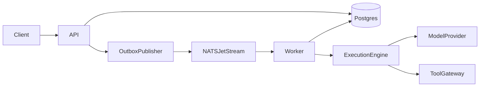

# AgentOS

AgentOS is a local runtime for registering AI agents, queueing their tasks durably, executing model and tool steps, and resuming work after a worker crash.

The first milestone is a single API process and a single worker. Postgres stores tasks, leases, steps, and checkpoints. NATS JetStream wakes the worker. The worker also polls Postgres, so a lost message does not drop a task.



## Stack

Python 3.12, FastAPI, Pydantic, SQLAlchemy, Alembic, PostgreSQL, NATS JetStream. Redis, OpenTelemetry, Prometheus, Grafana, pgvector, and the React dashboard are later milestones.

## Local setup

Install [uv](https://docs.astral.sh/uv/) and Docker.

```bash
cp .env.example .env
make install
docker compose up --build
```

The API listens on `http://127.0.0.1:8000`. Compose sets `AGENTOS_BOOTSTRAP_API_KEY` to `local-dev-key` and runs migrations before Uvicorn starts. `make up` starts only Postgres and NATS, which is enough for the test suite.

## Usage

Register an agent that may call `add`, submit a task, and read the execution. The scripted provider turns `add 2 and 3` into a tool call and then a final answer.

```bash
curl -s -X POST http://127.0.0.1:8000/v1/agents \
  -H "Authorization: Bearer local-dev-key" \
  -H "Content-Type: application/json" \
  -d '{"name":"Calculator","slug":"calculator","tool_names":["add"]}'

curl -s -X POST http://127.0.0.1:8000/v1/tasks \
  -H "Authorization: Bearer local-dev-key" \
  -H "Content-Type: application/json" \
  -d '{"agent_id":"<agent-id>","input":{"text":"add 2 and 3"},"idempotency_key":"demo-1"}'

curl -s http://127.0.0.1:8000/v1/executions/<execution-id> \
  -H "Authorization: Bearer local-dev-key"
```

Repeating the same idempotency key and payload returns the original task. A different payload for that key returns 409.

`uv run python examples/demo_task.py` registers an agent, waits for a task to succeed, plants an expired lease after the tool step, and checks that recovery finishes with result `5` and a single tool step.

## API

All `/v1` routes require `Authorization: Bearer <api key>`.

- `GET /health` and `GET /ready`
- `POST /v1/agents`, `GET /v1/agents`, `GET /v1/agents/{id}`
- `POST /v1/tasks`, `GET /v1/tasks/{id}`, `POST /v1/tasks/{id}/cancel`
- `GET /v1/executions/{id}` returns the execution and its steps

Task input is a JSON object. The scripted provider reads `input.text`. Milestone 1 accepts `model_provider: scripted` only.

## Testing

```bash
make lint
make typecheck
make test-unit
make up
make test-integration
```

Integration tests create `agentos_test` and `agentos_repo` on the local Postgres instance. They need NATS JetStream on `nats://localhost:4222`.

## Benchmarks and limitations

No benchmark numbers are recorded. The method is in [docs/benchmarks.md](docs/benchmarks.md). Delivery is at-least-once, tenant filters are application-level, and builtin tools run inside the worker process. Details are in [docs/limitations.md](docs/limitations.md).

## Documentation

- [Architecture](docs/architecture.md)
- [Design decisions](docs/design-decisions.md)
- [Implementation plan](docs/implementation-plan.md)
- [Limitations](docs/limitations.md)
- [Benchmarks](docs/benchmarks.md)
- [Progress](docs/progress.md)

## License

MIT.
