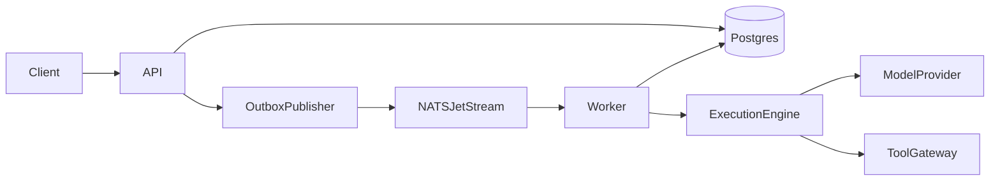

# AgentOS

AgentOS is a local runtime for registering AI agents, queueing their tasks durably, executing model and tool steps, and resuming work after a worker crash.

The first milestone is a single API process and a single worker. Postgres stores tasks, leases, steps, and checkpoints. NATS JetStream wakes the worker. The worker also polls Postgres, so a lost message does not drop a task.



## Stack

Python 3.12, FastAPI, Pydantic, SQLAlchemy, Alembic, PostgreSQL, NATS JetStream. Redis, OpenTelemetry, Prometheus, Grafana, pgvector, and the React dashboard are later milestones.

## Local setup

Install [uv](https://docs.astral.sh/uv/) and Docker.

```bash
cp .env.example .env
make install
make up
make test-unit
make lint
make typecheck
```

`make up` starts Postgres and NATS. The API and worker commands are added with those features. Usage examples will be updated when the vertical slice is complete.

## Documentation

- [Architecture](docs/architecture.md)
- [Design decisions](docs/design-decisions.md)
- [Implementation plan](docs/implementation-plan.md)
- [Limitations](docs/limitations.md)
- [Benchmarks](docs/benchmarks.md)
- [Progress](docs/progress.md)

## License

MIT.
