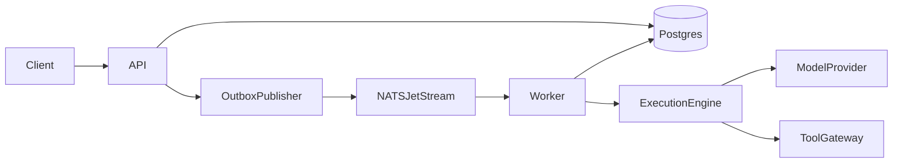
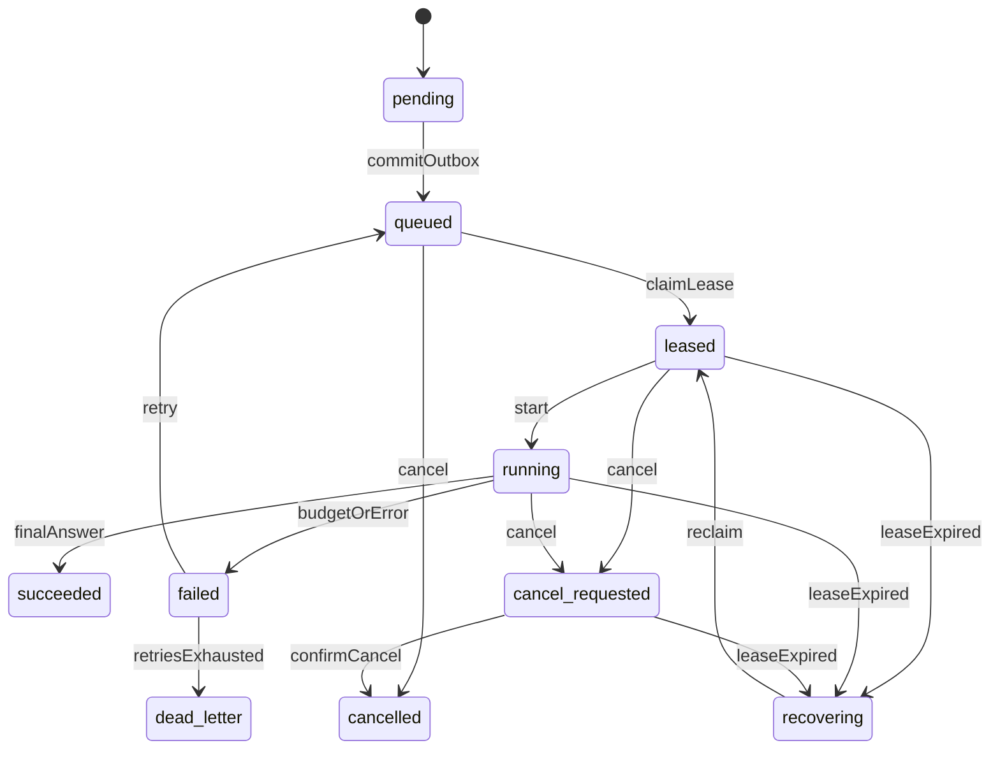

# Architecture

AgentOS runs long-lived agent work on a durable execution log. Postgres is the source of truth. NATS JetStream is a wake-up signal. One API process and one worker process share a domain library. The product services below are packages inside that library, not separate network services.

## Components

| Package | Responsibility |
| --- | --- |
| `agentos.api` | Registration, task submission, cancellation, status, API-key authentication |
| `agentos.repositories` | Tenant-scoped persistence for agents, tasks, executions, and leases |
| `agentos.domain` | Execution state machine and domain errors |
| `agentos.messaging` | Transactional outbox and JetStream publisher |
| `agentos.worker` | Claim work, heartbeat, recover expired leases, run the engine |
| `agentos.execution` | Model and tool steps, checkpoints, budgets, cancellation |
| `agentos.providers` | Model adapter protocol. Milestone 1 ships a scripted provider |
| `agentos.tools` | JSON Schema validation, permission checks, timeouts, builtin handlers |
| `agentos.db` | SQLAlchemy models and sessions |

Memory retrieval, a React dashboard, OpenTelemetry, Prometheus, and Redis rate limiting stay outside this process boundary until their milestones. Working memory for a run lives in the checkpoint document.

## Durable delivery

Submitting a task inserts the task, an execution, an audit event, and an outbox row in one database transaction. A publisher reads unpublished outbox rows and publishes them to `agentos.tasks.{organization_id}` on the `AGENTOS` stream. The worker treats the message as a hint:

1. Claim the execution in Postgres with `FOR UPDATE SKIP LOCKED`.
2. Acknowledge the message after the claim attempt.
3. A reconciliation query also selects queued executions, so a lost message does not lose the task.

Duplicate delivery is safe. A second worker finds the execution already leased or terminal and skips it.

## Leases and fencing

`worker_leases` stores `worker_id`, `fencing_token`, and `expires_at`. The worker heartbeats the expiry. On startup, and on each loop, the worker moves executions whose leases have expired from `leased` or `running` to `recovering`, then claims them with `fencing_token + 1`.

Step and checkpoint writes include `WHERE fencing_token = :token`. A stale worker updates zero rows and stops. Completed steps are not executed again. A step left in `running` is retried. That retry is at-least-once. See [limitations.md](limitations.md).

Task status mirrors the latest execution and changes in the same transaction.

## Scheduling

Milestone 1 has no separate scheduler process. The worker claims the oldest highest-priority queued or recovering execution whose agent is under `max_concurrency`. Ordering is `priority DESC, created_at ASC`. Fair multi-tenant scheduling is a later milestone. The priority column is already used by the claim query.

## Model and tool boundary

`ModelProvider.complete` is the only model interface. The scripted provider returns deterministic tool calls for local demo prompts (including multi-step chains such as add-then-multiply), then a final answer after the last tool result. No network call and no provider key are required.

Tools are an allowlist of in-process handlers (`echo`, `add`, `multiply`, `concat`, `lookup`). The gateway validates arguments against the tool JSON Schema, checks `tool_permissions` for the agent version, and applies an asyncio timeout. Handlers do not receive a shell or a host filesystem path.

## Security boundary

Authentication is a bearer API key. The database stores the SHA-256 hash and a display prefix. Every repository query is scoped by the `organization_id` on that key. Postgres row-level security is not enabled. A missed filter is a tenant-isolation bug. That gap is recorded in [limitations.md](limitations.md).

Docker isolates the API and worker processes from the host. It does not isolate one tool invocation from the worker. Untrusted code execution is out of scope until a sandbox milestone.

## Extraction path

The API and worker already use different entrypoints and share the database. Splitting a package into its own service later means giving it a client for the repository interface it uses today. The outbox is the existing seam for task dispatch.
